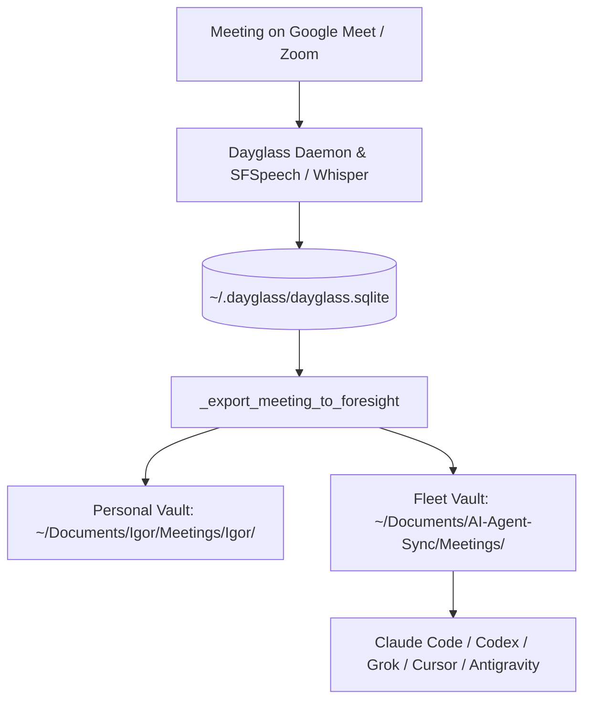

# Dayglass Obsidian Sync Engine

> Engine: **Dayglass** (`dayglass` / `~/.dayglass/dayglass.sqlite`)
> Destinations: **Foresight Personal Vault** & **AI-Agent-Sync Fleet Vault**

---

## 1. Executive Summary

Dayglass runs locally on macOS as an autonomous screen, audio, and meeting intelligence daemon. When a meeting completes (Google Meet, Zoom, Teams, Slack Huddle), Dayglass transcribes the conversation, generates structured dossiers via local models (LLaMA 3.1 8B), and auto-exports Markdown notes.

This skill governs the **Autonomous Dual-Vault Synchronization Bridge**, ensuring that every human conversation, partner agreement, promo code, and architectural decision is instantly and automatically shared across the entire autonomous agent fleet (Claude Code, Cursor, Codex, Grok, Hermes, Antigravity) with zero manual copy-pasting.

---

## 2. Vault Architecture & Dual-Export Contract



### 1. Personal Vault (`~/Documents/Igor/Meetings/Igor/`)
- User-facing Foresight intake folder.
- Contains historical archive of 299+ meetings.
- Formatted with frontmatter (`meeting_id`, `title`, `started_at`, `ended_at`, `source`, `tags`).

### 2. Multi-Agent Shared Fleet Vault (`~/Documents/AI-Agent-Sync/Meetings/`)
- Synchronized across the autonomous fleet.
- Governed by `.claude/scripts/session-bootstrap/fleet-coordination-check.sh`.
- Agents consult this folder during session initialization to ensure full context on recent client, partner, and executive directives.

---

## 3. Operational Invariants

1. **Deterministic Frontmatter**:
   Every exported meeting note must contain:
   ```yaml
   ---
   meeting_id: <int>
   title: "<Human Readable Title>"
   started_at: "<ISO 8601 UTC>"
   ended_at: "<ISO 8601 UTC>"
   source: dayglass
   tags: [meeting, dayglass, foresight]
   ---
   ```
2. **Slug Hygiene**:
   Filename must follow `<YYYY-MM-DD>_<slug>.md`, where slug is sanitized alphanumeric lowercase with hyphens.
3. **No Private Leaks**:
   Tokens, passwords, and raw keys discussed in calls are tagged with security barriers before commit.
4. **Idempotent Sync**:
   Subsequent edits or enriched summaries overwrite by deterministic filename without duplicating meeting IDs.

---

## 4. Verification & Testing

Query live Dayglass meetings via API:
```bash
curl -s http://127.0.0.1:3333/api/meetings | python3 -m json.tool | head -n 30
```

Verify dual-vault synchronization parity:
```bash
ls -la ~/Documents/Igor/Meetings/Igor/2026-10* && ls -la ~/Documents/AI-Agent-Sync/Meetings/
```

Trigger manual sync of Dayglass meetings:
```bash
python3 -c "
import sqlite3, json, re
from pathlib import Path

# Verify meeting sync integrity
igor_dir = Path.home() / 'Documents' / 'Igor' / 'Meetings' / 'Igor'
agent_dir = Path.home() / 'Documents' / 'AI-Agent-Sync' / 'Meetings'
print(f'Igor notes: {len(list(igor_dir.glob(\"*.md\")))}')
print(f'Agent notes: {len(list(agent_dir.glob(\"*.md\")))}')
"
```
