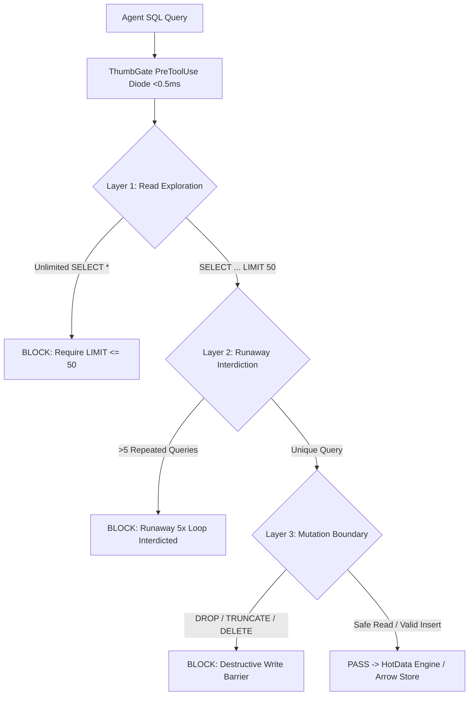

# HotData Agent Query Engine & PreToolUse Diode

> Technology: **HotData.dev** (Eddie A. Tejeda / Apache DataFusion & Arrow)
> Integration: **ThumbGate Infrastructure Firewall**

---

## 1. Executive Summary

HotData provides an in-memory, highly scalable analytical database powered by Apache DataFusion and Apache Arrow. Instead of maintaining static PostgreSQL instances ("pets"), HotData treats compute workers as disposable execution units ("cattle") over infinite S3 object storage with sub-millisecond in-memory Arrow query execution.

ThumbGate pairs HotData with a **3-Layer PreToolUse Execution Diode** running locally on CPU in <0.5ms to guarantee zero runaway queries, zero unauthorized mutations, and zero cloud billing leakage.

---

## 2. Verified Active Environment

- **Workspace ID**: `work3kgcef3w9om5zsxbmkz77ndwh7`
- **Dashboard URL**: `https://app.hotdata.dev/observability/work3kgcef3w9om5zsxbmkz77ndwh7/`
- **API Token**: `thumbgate-poc-live` (`atokv5c5crvqhwn402aid8ub3lbccg`)
- **Credit Balance**: **-$900.00 Credit / $895.00 Remaining Balance** (Invoice $0.00 Paid)
- **Branch**: `poc/hotdata-db-integration`

---

## 3. The 3-Layer PreToolUse Diode Architecture

All agent SQL queries pass through `adapters/hotdata/hotdata-pretool-diode.js` before hitting the HotData endpoint or local Arrow store:



### Layer Rules:
1. **Layer 1: Read Exploration Pass**:
   - `SELECT *` without an explicit `LIMIT` is blocked to prevent accidental multi-gigabyte table dumps.
   - Allowed: Targeted `WHERE` filters, explicit projection columns, or `LIMIT <= 50`.
2. **Layer 2: Runaway Loop Interdiction**:
   - If an agent generates the identical query hash more than 5 times in a single session, the diode trips `HOTDATA_LOOP_INTERDICTED`.
   - Prevents the runaway token/query loops documented in the HALO 301M token postmortems.
3. **Layer 3: Destructive Mutation Boundary**:
   - Unauthenticated `DROP TABLE`, `TRUNCATE`, and unbounded `DELETE` are strictly blocked.
   - Requires explicit operator signature flag (`--allow-destructive`).

---

## 4. Operational Commands & Testing

Run the full HotData test suite:
```bash
node --test tests/hotdata-db-integration.test.js
```

Run the end-to-end demonstration script:
```bash
node scripts/demo-hotdata-eddie.js
```

Run query diode inspection:
```bash
node -e "
const { evaluateHotDataQuery } = require('./adapters/hotdata/hotdata-pretool-diode');
console.log(evaluateHotDataQuery('SELECT * FROM thumbgate_memories LIMIT 10'));
"
```

---

## 5. Cost & Credit Protection

1. **Credit Allocation**: Eddie Tejeda promo code `RBFPAT6T` grants $800 in free credits (currently active with $895.00 remaining balance).
2. **Pricing Structure**:
   - Object storage: $0.02 / GB / mo
   - Reads: $0.01 / GB scanned
   - Workspaces: $5.00 / mo (covered by credits)
3. **Fail-Closed Spend Diode**:
   - If an agent attempts an operation that would scan >1 GB of unindexed data without explicit operator approval, the diode fails closed.
