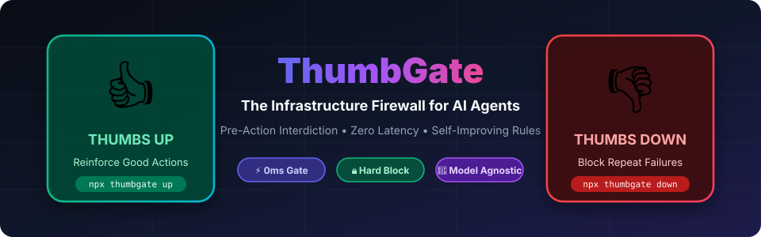
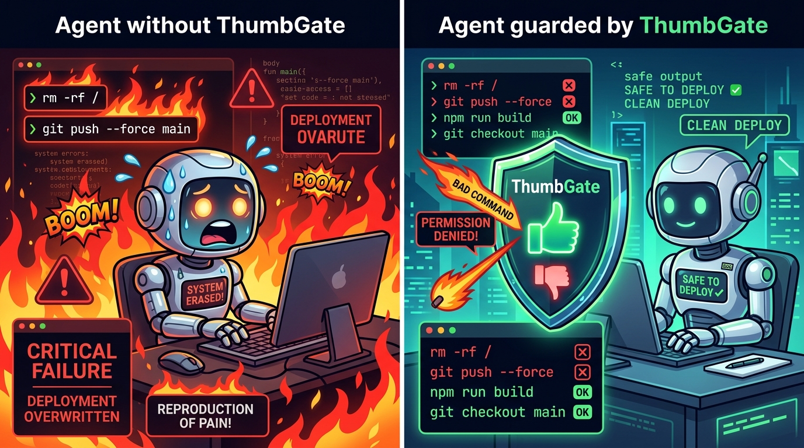
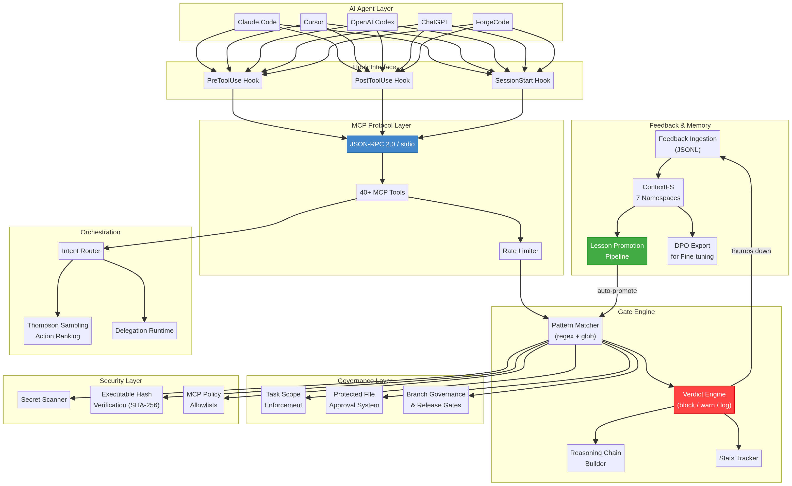
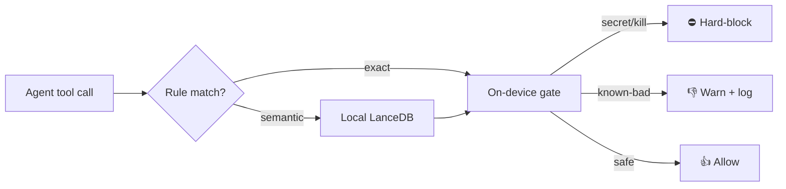
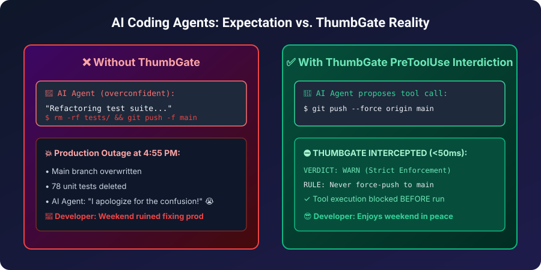
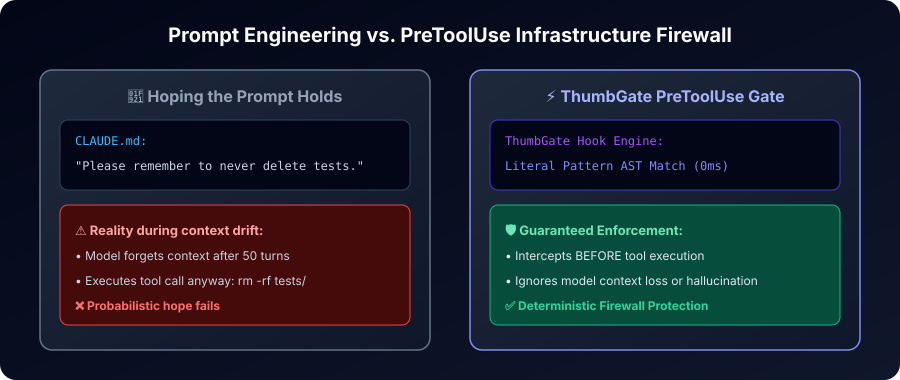

# ThumbGate 👍 👎

<p align="center">
  <a href="https://thumbgate.ai">
    
  </a>
</p>

<p align="center">
  <b>ThumbGate checks AI coding actions before they run: allow, warn or deny</b><br>
  It checks every tool call your agent is about to make and stops the dangerous ones before they run.
</p>

<p align="center">
  <a href="https://github.com/IgorGanapolsky/ThumbGate/actions/workflows/ci.yml"></a>
  <a href="https://www.npmjs.com/package/thumbgate"></a>
  <a href="https://www.npmjs.com/package/thumbgate"></a>
  <a href="LICENSE"></a>
</p>

## What it does

AI coding agents repeat mistakes — and one wrong tool call can wipe a directory, leak a key, or push broken code.

ThumbGate is the local-first **Pre-Action Checks** engine for AI coding agents. It runs in the PreToolUse hook to evaluate the proposed tool call before execution — so costly mistakes can be caught before they happen.

- **Blocks the worst commands out of the box:** secret leaks, force-push, `git reset --hard`, `rm -rf` on home or root, `DROP TABLE`.
- **Learns from your 👎:** tell it once what went wrong, and the same mistake gets flagged next time.
- **Runs on your machine:** no account and no cloud needed for the checks.

Works with **Claude Code, Cursor, Codex, Gemini CLI, Amp, Cline, OpenCode**, and other MCP agents. [**▶ 90-second demo**](https://thumbgate.ai/#demo?utm_source=github&utm_medium=readme&utm_campaign=demo_video) · [GIF walkthrough](docs/media/thumbgate-demo.gif)

---

## Quick Start

You need Node.js 18 or newer. Run these two commands in the project where your agent works:

```bash
npx thumbgate init      # finds your agent (Claude Code, Cursor, Codex, ...) and installs the hooks
npx thumbgate doctor    # checks that the hooks are really wired
```

**What success looks like:** `doctor` prints `Overall: READY` and exits with code 0. If it says something is missing, it lists what to fix; run `init` again or pick your agent from the [table below](#install-for-your-agent).

That's it. The built-in checks are now active. Your agent can keep working as usual; ThumbGate only speaks up when a tool call matches a check.

**See a block without risking anything.** This hands ThumbGate the same input your agent's hook would, without running the command:

```bash
echo '{"tool_name":"Bash","tool_input":{"command":"git push --force"}}' | npx thumbgate gate-check
```

You get `"permissionDecision":"deny"` and `[GATE:force-push] Force push blocked.` In a real session, the agent gets that answer and the push never runs.

### Teach it your first rule (optional)

When your agent does something you never want repeated, give it a thumbs-down:

In Claude Code you can also install it as a plugin:

```
/plugin install thumbgate --marketplace IgorGanapolsky/ThumbGate
```

```bash
npx thumbgate capture --feedback=down --context="Never run DROP on production tables" --what-went-wrong="agent proposed DROP" --what-to-change="require review for DROP"
```

From then on the agent sees that lesson before a matching action. After three matching thumbs-downs it becomes a check that warns, or blocks with `THUMBGATE_STRICT_ENFORCEMENT=1`. (`DROP TABLE` itself is already denied by default.)

To see your rules and what was caught, run `npx thumbgate dashboard --open`. An empty dashboard on day one is normal; it means nothing has fired yet.

Want a phased walkthrough with a verify step at every stage? Follow the [Progressive Setup Guide](GUIDE.md) ([Progressive wiring](https://thumbgate.ai/guides/progressive-wiring) online; numbered configs in [`config/progressive/`](config/progressive/)).

---

## Install for your agent

| Agent | Command | Enforcement |
|-------|---------|-------------|
| **Claude Code** | `npx thumbgate init --agent claude-code` | 🛡️ Hard — PreToolUse |
| **Codex** | `npx thumbgate init --agent codex` | 🛡️ Hard — `pre_tool_use` |
| **Gemini CLI** | `npx thumbgate init --agent gemini` | 🛡️ Hard — PreToolUse |
| **ForgeCode** | `npx thumbgate init --agent forge` | 🛡️ Hard — `pre_tool_use` |
| **Cursor** | `npx thumbgate init --agent cursor` | 🛡️ Hard for shell commands — `beforeShellExecution` hook denies them. 💬 Advisory for every other Cursor tool (file edits, MCP calls) — MCP `gate_check`. If the hook errors, the command is denied (fails closed; see [Cursor adapter](adapters/cursor/CURSOR.md#what-happens-when-the-hook-fails)). |
| **Cline** | `npx thumbgate init --agent cline` | 💬 Advisory — MCP + `.clinerules` |
| **OpenCode** | `npx thumbgate init --agent opencode` | 💬 Advisory — MCP `gate_check` |
| **Any MCP agent** | `npx thumbgate serve` | 💬 Advisory — MCP `gate_check` |
| **Amp** | `npx thumbgate init --agent amp` | 📝 Feedback capture |
| **GitHub Actions** | `uses: IgorGanapolsky/ThumbGate@v1` | 🩺 Marketplace Action — doctor / AI inventory in CI |

Per-agent guides: [Claude/Codex bridge](plugins/claude-codex-bridge/README.md) · [Codex profile](plugins/codex-profile/README.md) · [Cursor](docs/CURSOR_PLUGIN_OPERATIONS.md) · [MCP setup](docs/MCP_AUTONOMOUS_SETUP.md)

### Install scope: machine-wide vs per-project

| Scope | Command | Claude Code hooks | MCP entry | Lessons and dashboard data |
|-------|---------|-------------------|-----------|----------------------------|
| **Machine-wide** (default) | `npx thumbgate init` | `~/.claude/settings.json`, so they run in every repo on this machine | `<repo>/.mcp.json` | `<repo>/.thumbgate/` |
| **Per-project** | `npx thumbgate init --project` | `<repo>/.claude/settings.json`, so they run only in this repo | `<repo>/.mcp.json` | `<repo>/.thumbgate/` |

Lessons stay per repo in both scopes: a 👎 in `repo-A` does not flag anything in `repo-B`. Cross-repo blocking is not automatic. Versions before 1.31 kept lessons in `<repo>/.claude/memory/feedback/` or `~/.thumbgate/projects/<name>/`. ThumbGate reads `<repo>/.thumbgate/` first once it exists, and `init` creates it, so copy the old files into `<repo>/.thumbgate/` to keep those lessons. Keep `.thumbgate/` out of git. Inits before 1.43.2 wrote hooks to `~/.claude/settings.local.json`, which Claude Code does not read. From 1.43.2 the ThumbGate MCP server moves them to `~/.claude/settings.json` the next time it starts (set `THUMBGATE_DISABLE_CLAUDE_SELF_HEAL=1` to stop that), `npx thumbgate init` moves them right away, and `npx thumbgate doctor` tells you if they are still in the old file. `<repo>/.claude/settings.json` is the file teams usually commit, so check the hook paths in it before you commit it.

For an MCP-only install, `npx thumbgate install-mcp` adds `mcpServers.thumbgate` to `~/.claude/settings.json`, and `npx thumbgate install-mcp --project` adds it to `<repo>/.claude/settings.json` instead. Neither writes hooks.

**MCP tools (surface):** `gate_check` (read/evaluate proposed tool call), feedback capture + session tools (write), dashboard/stats (read). Destructive agent actions stay blocked/warned by PreToolUse — ThumbGate does not execute user shell commands for you.

### Any MCP client, Glama, or registry install (stdio)

Directories and clients that install ThumbGate as an MCP server must start **stdio MCP**, not the HTTP API:

```bash
npx -y thumbgate serve
```

- Equivalent: `npx -y thumbgate mcp`
- Do **not** use `npm start` for MCP — that launches the hosted HTTP API (`src/api/server.js`), not the agent-facing stdio server.

---

## What a 👍 and a 👎 do

| You give | What ThumbGate does |
|----------|---------------------|
| 👎 typed in the agent session right after a command | Turns that command into a check. The first one warns on the next run. A second 👎 from you on the same command blocks it, with or without strict mode. |
| 👎 from the CLI with only a sentence of context (no command attached) | Saves a lesson the agent sees before a matching action. On the third matching 👎, a check fires: a warning by default, a block with `THUMBGATE_STRICT_ENFORCEMENT=1`. |
| 👍 with one sentence of context | Saves a success lesson and counts it in your stats. It does not create, loosen or lift a check. |
| 👍 or 👎 with no context and no command | Logged only. Nothing is stored or promoted. |

Example: the agent runs `npm run deploy:staging` and you type *"thumbs down: that pushed to the wrong environment"*. The next `npm run deploy:staging` gets a warning before it runs. You thumbs-down it a second time, and the next run is denied. A later 👍 on the same command is saved as a success lesson, and the block stays in place.

---

## How it works (short)

1. **Capture** 👍/👎 feedback (CLI, MCP, linked feedback session flow / `open_feedback_session`, or [ThumbGate GPT](https://thumbgate.ai/go/gpt?utm_source=github&utm_medium=readme))
2. **Promote** concrete lessons via history-aware lesson distillation into prevention rules
3. **Evaluate** the next proposed tool call against active rules (literal/AST + local vectors)
4. **Allow / warn / deny** before the tool runs

```bash
npx thumbgate brain --write   # → .thumbgate/BRAIN.md (lessons + gates in one artifact)
```

Pro operators can invoke `search_lessons` through MCP and use `npx thumbgate lessons` from the CLI. History-aware feedback sessions and lesson search are Pro capabilities; Free does not include recall or search.

### How enforcement works

It **hard-blocks detected secret leaks and two direct self-disable command classes by default** — commands that terminate the ThumbGate gate process or enable its bypass environment override. It also denies catastrophic commands by default: force-push, `git reset --hard`, `git clean -f`, `rm -rf` on home or root, and `DROP TABLE`. Other high-risk classes (fetch-and-run, direct guardrail edits, other matching rules) **warn and log by default**. Set `THUMBGATE_STRICT_ENFORCEMENT=1` for strict enforcement (warnings become hard denies).

| Verdict | Default behavior |
|---------|------------------|
| ⛔ **Hard-block** | Detected secret leaks; process-kill/environment-override self-disable; catastrophic commands (force-push, `git reset --hard`, `git clean -f`, `rm -rf` on home or root, `DROP TABLE`) |
| 👎 **Warn + log** | fetch-and-run, direct guardrail edits, other matching rules (become hard denies with `THUMBGATE_STRICT_ENFORCEMENT=1`) |
| 👍 **Allow** | Everything else |

**Accepted feedback is stored as local lessons.** Repeated concrete failures can become prevention rules that promote from warnings to blocking gates. The firewall improves from operations without retraining the model. Prompt evaluation (`npx thumbgate eval`) turns accepted feedback into reusable eval cases and local proof reports.

**Honest disclaimer:** ThumbGate does not update model weights. It intercepts tool calls at runtime. Local-first — no cloud required for the enforcement path.

[](https://thumbgate.ai/#demo?utm_source=github&utm_medium=readme_meme)

```
  Agent tries:   rm -rf tests/
  ThumbGate:     👎 WARN + LOG — "Never delete test directories"
                 Pattern matched: rm.*-rf.*tests
                 Source: your thumbs-down from last Tuesday
                 Strict mode: ⛔ DENY before tool execution
```

<details>
<summary><b>Architecture diagram & stack</b></summary>

[](https://thumbgate.ai/#how-it-works)



</details>

<details>
<summary><b>Built-in checks</b></summary>

```
⛔ secret-exfiltration → hard-block (default)
⛔ self-protect-kill   → hard-block (default)
⛔ self-protect-env    → hard-block (default)
⛔ force-push          → hard-block (default)
⛔ git-reset-hard      → hard-block (default)
⛔ git-clean-force     → hard-block (default)
⛔ rm-rf-home-or-root  → hard-block (default)
⚠️ protected-branch    → warn; hard-block under strict
⚠️ unresolved-threads  → warn; hard-block under strict
⚠️ package-lock-reset  → warn; hard-block under strict
```

</details>

<details>
<summary><b>CLI cheatsheet</b></summary>

```bash
npx thumbgate init
npx thumbgate doctor
npx thumbgate capture up|down "<text>"
npx thumbgate lessons
npx thumbgate brain --write
npx thumbgate dashboard --open
npx thumbgate break-glass --reason="ThumbGate over-fired"   # 5-min recovery
```

</details>

<details>
<summary><b>Pro: lesson + DPO export</b></summary>

```bash
# Portable lessons
curl -X POST http://localhost:3456/v1/lessons/export \
  -H "Authorization: Bearer $THUMBGATE_API_KEY" \
  -H "Content-Type: application/json" \
  -d '{"outputPath": "./lessons-export.json"}'

# DPO pairs for fine-tuning
curl -X POST http://localhost:3456/v1/dpo/export \
  -H "Authorization: Bearer $THUMBGATE_API_KEY" \
  -o dpo-pairs.jsonl
```

</details>

### Agentic development cycle fit

Agentic development is becoming a loop: **Guide → Generate → Verify → Solve**. ThumbGate is the pre-action gate / pre-action boundary between generated intent and executed action.

---

## Discoverable slash-commands — the guardrail layer for spec-driven agents

Spec-driven agent frameworks like **GSD** (get-shit-done) and **GitHub Spec Kit** plan and generate work. ThumbGate is the **guardrail layer for spec-driven agents**: it sits *after* the plan, on the boundary between a generated tool call and its execution — **alongside GSD / Spec-Kit, not instead of them**.

`npx thumbgate init` installs these into your agent palette:

| Command | What it does |
|---------|--------------|
| `/thumbgate-dashboard` | Open local project dashboard |
| `/thumbgate-guard` | Turn last mistake into a hard prevention rule |
| `/thumbgate-rules` | List active rules & lessons |
| `/thumbgate-blocked` | Gate stats + enforcement matrix |
| `/thumbgate-protect` | Branch governance + scoped approval |
| `/thumbgate-doctor` | Health-check hooks, MCP, readiness |


---

## Integrations (compact)

| Surface | Start here |
|---------|------------|
| **Open ThumbGate GPT** | [thumbgate.ai/go/gpt](https://thumbgate.ai/go/gpt?utm_source=github&utm_medium=readme&utm_campaign=readme_gpt) — **ThumbGate GPT: start here.** Paste agent actions, get advice + checkpointing. **No, users do not have to keep chatting inside the ThumbGate GPT to use ThumbGate** — the **hard enforcement layer still runs where the work happens**. |
| **Install Codex Plugin** | Open the Codex plugin install page: [thumbgate.ai/codex-plugin](https://thumbgate.ai/codex-plugin) · zip: [thumbgate-codex-plugin.zip](https://github.com/IgorGanapolsky/ThumbGate/releases/latest/download/thumbgate-codex-plugin.zip) · [plugins/codex-profile/INSTALL.md](plugins/codex-profile/INSTALL.md) |
| Claude Desktop `.mcpb` | [latest release](https://github.com/IgorGanapolsky/ThumbGate/releases/latest/download/thumbgate-claude-desktop.mcpb) |
| **VS Code / Open VSX** | [plugins/vscode-extension/README.md](plugins/vscode-extension/README.md) |
| **Antigravity-compatible** | [plugins/antigravity-extension/INSTALL.md](plugins/antigravity-extension/INSTALL.md) |
| **JetBrains** | [plugins/jetbrains-plugin/README.md](plugins/jetbrains-plugin/README.md) · JetBrains Marketplace path for the same runtime |
| ChatGPT App / GPT Action | [thumbgate.ai/chatgpt-app](https://thumbgate.ai/chatgpt-app) |
| ThumbGate-Core (staging) | [https://github.com/IgorGanapolsky/ThumbGate-Core](https://github.com/IgorGanapolsky/ThumbGate-Core) — pre-release staging + a few internal cache scripts; **not** the product moat |

<!-- host-gate-matrix:start -->
## Gate coverage by host

Which gates were actually denied on which host. Generated by `npm run compat:matrix` from real runs through each host's hook path; nothing here is typed by hand. "enforced" means a test ran that gate's denial through that host in this checkout. "not enforced" means the command ran and was allowed. "untested" means no run exists. Details and the exact check per host: [docs/host-compatibility.md](docs/host-compatibility.md).

| Gate | Claude Code | Cursor | Codex | Gemini CLI |
|---|---|---|---|---|
| `force-push` | enforced | enforced | untested | untested |
| `git-reset-hard` | enforced | enforced | untested | untested |
| `git-clean-force` | enforced | enforced | untested | untested |
| `rm-rf-home-or-root` | enforced | enforced | untested | untested |
| `cloud-bulk-delete` | enforced | enforced | untested | untested |
| `terraform-destroy` | enforced | enforced | untested | untested |
| `kubectl-bulk-delete` | enforced | enforced | untested | untested |
| `docker-system-prune-all` | enforced | enforced | untested | untested |
| `iam-policy-change` | enforced | enforced | untested | untested |
| Held after one thumbs-down, gate after two | enforced | enforced | untested | untested |
| Text typed in a chat window or web page | out of scope | out of scope | out of scope | out of scope |

### Which hosts hard-stop, and how they fail

| Host | Hard-stops a bad call | Fails open or closed | Evidence |
|---|---|---|---|
| Claude Code | yes (9 of 9 gates denied) | Fails open | [docs/host-compatibility.md](https://github.com/IgorGanapolsky/ThumbGate/blob/main/docs/host-compatibility.md) |
| Cursor | yes (9 of 9 gates denied) | Fails closed | [tests/cursor-fail-closed.test.js](https://github.com/IgorGanapolsky/ThumbGate/blob/main/tests/cursor-fail-closed.test.js) |
| Codex | untested | untested | [docs/host-compatibility.md](https://github.com/IgorGanapolsky/ThumbGate/blob/main/docs/host-compatibility.md) |
| Gemini CLI | untested | untested | [docs/host-compatibility.md](https://github.com/IgorGanapolsky/ThumbGate/blob/main/docs/host-compatibility.md) |
| Cline | no, warns only | no hook, so not applicable | [tests/advisory-hosts-honesty.test.js](https://github.com/IgorGanapolsky/ThumbGate/blob/main/tests/advisory-hosts-honesty.test.js) |
| OpenCode | no, warns only | no hook, so not applicable | [tests/advisory-hosts-honesty.test.js](https://github.com/IgorGanapolsky/ThumbGate/blob/main/tests/advisory-hosts-honesty.test.js) |
| Amp | no, warns only | no hook, so not applicable | [tests/advisory-hosts-honesty.test.js](https://github.com/IgorGanapolsky/ThumbGate/blob/main/tests/advisory-hosts-honesty.test.js) |
<!-- host-gate-matrix:end -->


---

## Pricing & buyer paths

Free tier: **2 feedback captures/day (10 total)** and **up to 3 active auto-promoted prevention rules**. Pro ($19/mo or $149/yr) is the individual tier for unlimited rules, history-aware lessons, linked feedback session flow, personal dashboard, and DPO export. **Enterprise is custom and scoped after intake**; hosted team lesson sync and a hosted org dashboard are not general availability.

| | Free | Pro ($19/mo or $149/yr) | Enterprise |
|---|---|---|---|
| Local CLI + PreToolUse | ✅ | ✅ | Scoped after intake |
| Feedback captures | 2 feedback captures/day (10 total) | Unlimited | Scoped after intake |
| Active auto-promoted rules | up to 3 active auto-promoted prevention rules | Unlimited | Scoped after intake |
| Personal dashboard + DPO export | — | ✅ | Reviewed during intake |
| Hosted team lesson sync | — | — | Not general availability |
| Hosted org dashboard | — | — | Not general availability |

**Team path:** request a **30-day team pilot**. Tell us your team size and coding agent, and a person replies by email with how the pilot would run. There is no self-serve team checkout. **[Request a team pilot →](https://thumbgate.ai/pilot?utm_source=github&utm_medium=readme&utm_campaign=team_rollout)**

**Local technical path:** install the CLI and use `init` plus the documented setup so Pre-Action Checks evaluate tool calls where the agent actually runs.

**First-dollar activation path:** open the [ThumbGate GPT](https://thumbgate.ai/go/gpt?utm_source=github&utm_medium=readme), paste the risky action, capture typed feedback (`thumbs down:` / `thumbs up:`). **Native ChatGPT rating buttons are not the ThumbGate capture path.** Ask: **what repeated AI mistake would be worth catching before the tool executes?**

**Paid path for individual operators:** [ThumbGate Pro](https://thumbgate.ai/go/pro-direct?utm_source=github&utm_medium=readme&utm_campaign=pro_page) is the self-serve side lane for a personal dashboard and export-ready evidence.

[**Start free**](https://thumbgate.ai/?utm_source=github&utm_medium=readme) · [**Pro $19/mo**](https://thumbgate.ai/go/pro-direct?utm_source=github&utm_medium=readme) · [**Live Dashboard**](https://thumbgate.ai/dashboard?utm_source=github&utm_medium=readme) · [**30-day team pilot**](https://thumbgate.ai/pilot?utm_source=github&utm_medium=readme&utm_campaign=top_cta) · [**First Dollar Playbook**](docs/FIRST_DOLLAR_PLAYBOOK.md)

<details>
<summary><b>More guides: popular buyer questions</b></summary>

**Popular buyer questions:** **[AI search topical presence](https://thumbgate.ai/guides/ai-search-topical-presence?utm_source=github&utm_medium=readme&utm_campaign=buyer_questions)** · **[Relational knowledge and AI recommendations](https://thumbgate.ai/guides/relational-knowledge-ai-recommendations?utm_source=github&utm_medium=readme&utm_campaign=buyer_questions)** · **[AI Mode ads for agent governance](https://thumbgate.ai/guides/ai-mode-ads-agent-governance?utm_source=github&utm_medium=readme&utm_campaign=buyer_questions)** · **[MCP tool governance](https://thumbgate.ai/guides/mcp-tool-governance?utm_source=github&utm_medium=readme&utm_campaign=buyer_questions)** · **[AI agent pre-action approval gates](https://thumbgate.ai/guides/ai-agent-pre-action-approval-gates?utm_source=github&utm_medium=readme&utm_campaign=buyer_questions)** · **[Background agent governance](https://thumbgate.ai/guides/background-agent-governance?utm_source=github&utm_medium=readme&utm_campaign=buyer_questions)** · **[GPT-5.5 model evaluation](https://thumbgate.ai/guides/gpt-5-5-model-evaluation?utm_source=github&utm_medium=readme&utm_campaign=buyer_questions)** · **[Stop repeated AI agent mistakes](https://thumbgate.ai/guides/stop-repeated-ai-agent-mistakes?utm_source=github&utm_medium=readme&utm_campaign=buyer_questions)** · **[Browser automation safety](https://thumbgate.ai/guides/browser-automation-safety?utm_source=github&utm_medium=readme&utm_campaign=buyer_questions)** · **[Native messaging host security](https://thumbgate.ai/guides/native-messaging-host-security?utm_source=github&utm_medium=readme&utm_campaign=buyer_questions)** · **[Autoresearch agent safety](https://thumbgate.ai/guides/autoresearch-agent-safety?utm_source=github&utm_medium=readme&utm_campaign=buyer_questions)** · **[Cursor guardrails](https://thumbgate.ai/guides/cursor-agent-guardrails?utm_source=github&utm_medium=readme&utm_campaign=buyer_questions)** · **[Codex CLI guardrails](https://thumbgate.ai/guides/codex-cli-guardrails?utm_source=github&utm_medium=readme&utm_campaign=buyer_questions)** · **[Gemini CLI memory + enforcement](https://thumbgate.ai/guides/gemini-cli-feedback-memory?utm_source=github&utm_medium=readme&utm_campaign=buyer_questions)** · **[Google Cloud MCP guardrails](https://thumbgate.ai/guides/gcp-mcp-guardrails?utm_source=github&utm_medium=readme&utm_campaign=buyer_questions)** · **[Roo Code alternative: migrate to Cline](https://thumbgate.ai/guides/roo-code-alternative-cline?utm_source=github&utm_medium=readme&utm_campaign=buyer_questions)**

</details>

---

## Tech Stack

| Layer | Tech |
|-------|------|
| **Runtime** | Node.js ≥18 |
| **Interfaces** | MCP stdio, HTTP API, CLI |
| **Storage** | SQLite + FTS5, LanceDB vectors, JSONL logs |
| **Intelligence** | MemAlign dual recall, Thompson Sampling, local embeddings |
| **Billing / host** | Stripe, Railway |
| **Execution** | Railway, Cloudflare Workers, Docker Sandboxes |
| **Governance** | Workflow Sentinel, control plane, Docker Sandboxes |

Every Changeset is tied to the exact `main` merge commit and generates Verification Evidence for Release Confidence.


## Cloud & model infrastructure

- **Local Pre-Action Checks & MCP Runtime**: Sub-`0.5ms` local `PreToolUse` enforcement (`npx thumbgate init`) across Claude Code, Cursor, Codex, and Gemini CLI; `TencentDB Agent Memory` record normalization into blocking SQL safety candidates is covered in `tests/memory-provider-enforcement-bridge.test.js`, and outer-harness context-budget checks inspired by Tencent Hunyuan `Hy-Memory-30B-A3B` research are validated in `scripts/rrsi-doctor.js`.
- **Companion Benchmark & Technical Case Study**: External evaluation of [Tencent Cloud](https://www.tencentcloud.com/) Lighthouse / CVM (`SA5` / `SA9` AMD Turin-Dense `3.4 GHz` all-core turbo in `ap-hongkong` & `ap-singapore`) and the `Hy-Memory-30B-A3B` surgical state-patching pattern is published in our companion `hermes-eval` benchmark repository (`docs/TENCENT-CLOUD-SA9-HUNYUAN-CASE-STUDY.md` and `scripts/tencent_sa9_hunyuan_benchmark.py`).

## Docs

Full index: **[docs/INDEX.md](docs/INDEX.md)**

| Need | Link |
|------|------|
| Agent workflow contract | [WORKFLOW.md](WORKFLOW.md) |
| Ready-for-agent intake | [.github/ISSUE_TEMPLATE/ready-for-agent.yml](.github/ISSUE_TEMPLATE/ready-for-agent.yml) |
| Cloud-to-Mac dispatch loop | [docs/guides/mac-dispatch-loop.md](docs/guides/mac-dispatch-loop.md) |
| Verification Evidence | [docs/VERIFICATION_EVIDENCE.md](docs/VERIFICATION_EVIDENCE.md) |
| Release Confidence | [docs/RELEASE_CONFIDENCE.md](docs/RELEASE_CONFIDENCE.md) |
| Changeset strategy | [docs/CHANGESET_STRATEGY.md](docs/CHANGESET_STRATEGY.md) |
| First Dollar Playbook | [docs/FIRST_DOLLAR_PLAYBOOK.md](docs/FIRST_DOLLAR_PLAYBOOK.md) |
| Security policy | [SECURITY.md](SECURITY.md) |
| Threat model | [THREAT_MODEL.md](THREAT_MODEL.md) |
| Federal / regulated | [docs/FEDERAL.md](docs/FEDERAL.md) |
| Commercial Truth | [docs/COMMERCIAL_TRUTH.md](docs/COMMERCIAL_TRUTH.md) |
| Issues / PRs | [GitHub Issues](https://github.com/IgorGanapolsky/ThumbGate/issues) · [PR template](.github/pull_request_template.md) |

**FAQ (one-liners):** Not a fine-tuner (runtime intercept only). Different from `CLAUDE.md` / `.cursorrules` (those are context; ThumbGate is an external allow/warn/deny before tools run).


---

## About this project

### Why usage, not stars

ThumbGate GitHub star growth is measured with GitHub's privacy-safe [`GET /repos/{owner}/{repo}/stargazers/history`](https://docs.github.com/en/rest/activity/starring#get-repository-star-history) endpoint (weekly counts, no stargazer identities). Run `npm run stars:history -- --fixture tests/fixtures/github-star-history.json --json` for the local proof. Stars are not npm installs and not revenue. The live GitHub Marketplace Action is [ThumbGate Agent Governance](https://github.com/marketplace/actions/thumbgate-agent-governance) (`uses: IgorGanapolsky/ThumbGate@v1`).

**Usage over star count.** Evaluate ThumbGate from the install path and live usage badges above (`npx thumbgate init`, Marketplace `uses:`, npm weekly downloads, GitHub clones), not from whether the repo has twenty stars or twenty thousand. No pitch deck is required. We do not farm GitHub profile badges (no YOLO-merge of protected `main`, no 5-minute Issue close theater, no fake `Co-authored-by`). Galaxy Brain needs real accepted answers in [Discussions Q&A](https://github.com/IgorGanapolsky/ThumbGate/discussions/categories/q-a). `npm run github:achievements -- --fixture tests/fixtures/github-achievements.json --json` inventories what is already earned vs what we refuse to farm.

#### Who it's for

ThumbGate is for operators whose AI coding agents can leak a secret or destroy a checkout before a human sees the tool call (Claude Code, Cursor, Codex, Gemini CLI, MCP). Discovery should reach those operators — not a star campaign.

ThumbGate is **not** a GitHub star package, not fake engagement, and not a substitute for npm installs or merged PRs. Real engagement is `npx thumbgate init` and a PreToolUse hook that actually fires.

#### Tech memes (shareable)

Lightweight visuals for how agents fail without a pre-action gate:

| Meme | Meaning |
|------|---------|
|  | Unchecked tool calls ship destructive commands. |
|  | A prompt is advice; a PreToolUse hook is enforcement. |

#### Listings

<a href="https://mcpservers.org/servers/igorganapolsky/thumbgate"></a>
<a href="https://mcptoplist.com/server/glama%2FIgorGanapolsky%2FThumbGate"></a>
<a href="https://github.com/IgorGanapolsky/ThumbGate"></a>
<a href="https://github.com/marketplace/actions/thumbgate-agent-governance"></a>

Also available: [ThumbGate GPT](https://thumbgate.ai/go/gpt?utm_source=github&utm_medium=readme) · [ThumbGate Pro ($19/mo)](https://thumbgate.ai/go/pro-direct?utm_source=github&utm_medium=readme)

---

## Who builds this

**Igor Ganapolsky** — payments (Stripe/Connect), AI agent guardrails/MCP, Android + backends. Small number of contract slots: **$120–150/hr, 1099, remote US**. [LinkedIn](https://www.linkedin.com/in/igor-ganapolsky-664324431/) · [thumbgate.ai](https://thumbgate.ai)

## Support ThumbGate

If ThumbGate saves you from a repeated agent mistake, you can [buy me a coffee](https://buymeacoffee.com/IgorGanapolsky).

## License

MIT — see [LICENSE](LICENSE). Project policy: [SECURITY.md](SECURITY.md) · [THREAT_MODEL.md](THREAT_MODEL.md).
