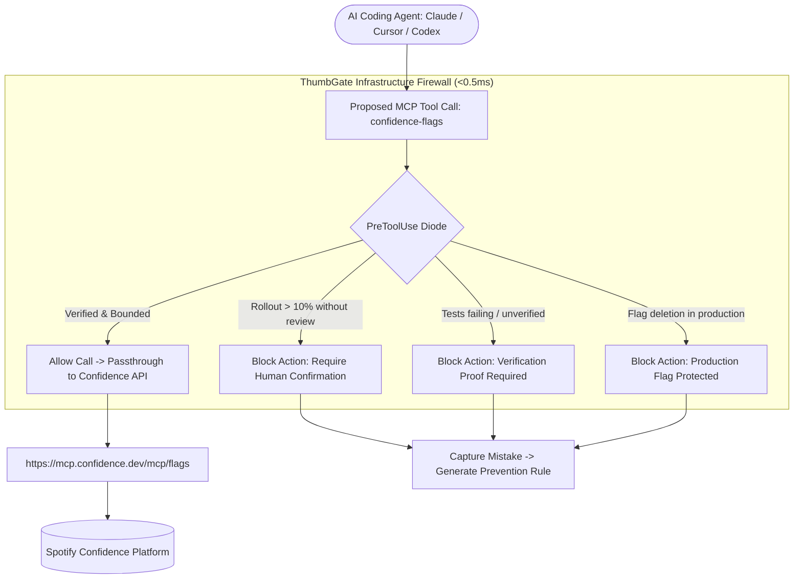

# Spotify Confidence + ThumbGate Pre-Action Governance Diode

> "As agentic coding tools rapidly change how products are built, we knew Confidence needed to evolve... releasing Confidence Agent, Recordings, Product Analytics, Confidence Cloud, and MCP servers for AI coding agents." — Spotify Confidence Team (October 14, 2026)

Spotify Confidence (`@spotify-confidence/cli`, `mcp.confidence.dev`) brings A/B testing, feature flagging, session recording, and automated experiment management into AI coding agents across **Claude Code**, **Cursor**, and **Codex**.

However, **autonomous AI agents executing unconstrained feature flag mutations in production pose severe operational risks:**
1. **Premature 100% Rollouts:** An agent rolls out a newly written feature flag to 100% of production traffic before verification tests pass or without canary verification.
2. **Experiment Degradation:** An agent modifies active A/B experiment variants or traffic splits mid-test, corrupting statistical power.
3. **Destructive Flag Deletion:** An agent deletes a legacy feature flag during codebase refactoring while client apps still depend on it.

**ThumbGate is the Pre-Action Infrastructure Firewall for Spotify Confidence.** It intercepts `confidence-flags` MCP invocations in sub-0.5ms and enforces deterministic governance diodes before flag mutation.

---

## Architecture: The Governed Confidence MCP Loop



---

## Pre-Action Governance Diodes for Confidence

| Diode / Gate ID | Trigger Condition | Enforcement Action |
| :--- | :--- | :--- |
| `gate:confidence:rollout_ceiling` | Agent attempts to set flag rollout $>10\%$ autonomously | **BLOCKED**: Hard ceiling at 10% canary. Rollout to $>10\%$ requires explicit operator approval. |
| `gate:confidence:test_proof_required` | Agent attempts to enable a flag while CI or local regression tests are failing | **BLOCKED**: Requires same-turn test execution receipt (`status: pass`). |
| `gate:confidence:protect_active_experiment` | Agent attempts to alter variants or sample sizes on an active A/B test | **BLOCKED**: Active experiments are locked against autonomous modification. |
| `gate:confidence:prevent_flag_deletion` | Agent attempts to delete a flag in production environments | **BLOCKED**: Flags must be marked archived before deletion. |
| `gate:confidence:behavior_named_flag` | Agent attempts to name a flag after a ticket (e.g. `JIRA-1234`) | **BLOCKED**: Flags must describe behaviour in kebab-case (e.g. `new-checkout-flow`). |
| `gate:confidence:owner_and_removal_date_required` | Agent creates a flag without explicit owner and planned removal date | **BLOCKED**: Mandatory ownership and cleanup lifecycle tracking. |
| `gate:confidence:default_off_fail_safe` | Agent creates a flag defaulting to `on` | **BLOCKED**: Flags must default to `off` to fail safe and decouple deploy from release. |
| `gate:confidence:guardrail_metrics_required` | Agent launches a rollout without attached guardrail metrics | **BLOCKED**: Crashes, latency, and error rate guardrails required before launch. |
| `gate:confidence:gradual_step_start_small` | Agent starts a rollout at $>5\%$ | **BLOCKED**: Initial gradual rollout step must start small (1–5%) and increase in steps. |
| `gate:confidence:rollback_trigger_required` | Agent launches a rollout without predefined automated rollback trigger | **BLOCKED**: Explicit rollback thresholds required before traffic shift. |
| `gate:confidence:metric_fact_table_grounded` | Agent creates or registers a metric not backed by a canonical fact table | **BLOCKED**: Every metric must be built on warehouse events (`fact_purchases`, `fact_tool_interceptions`). |
| `gate:confidence:user_id_flag_assignment_alignment` | Fact table user ID dimension mismatches flag assignment entity ID | **BLOCKED**: Mismatched IDs cause empty results; entity dimensions must align. |
| `gate:confidence:core_metrics_structure_enforced` | Experiment/suite violates 3–5 core metrics structure | **BLOCKED**: Exactly 1 North Star, 1–2 Drivers, and 1–2 Guardrails required. |
| `gate:confidence:outcome_not_proxy_integrity` | Agent configures misleading vanity proxy (stars, clicks, token counts) | **BLOCKED**: Primary metrics must track verified business and system outcomes. |
| `gate:confidence:project_context_required` | Confidence Agent invoked without an organised Project + linked surfaces | **BLOCKED**: Organise work in Projects (`bmvb3c1s5uxdnbgxmg3q`) so the agent uses project description, surfaces, and documents. |
| `gate:confidence:clear_outcome_prompt_required` | Confidence Agent invoked with a vague prompt lacking outcome/guardrail intent | **BLOCKED**: Start with a clear outcome prompt (e.g. `"Summarise the checkout test and flag any guardrail regressions."`). |
| `gate:confidence:review_before_act_guard` | Agent attempts to apply a Confidence Agent mutation on autopilot | **BLOCKED**: `"Review before you act. Treat it like a sharp teammate, not autopilot."` |

---

## "Define a Metric Once, Trust It Everywhere" Architecture

Following Johan Söderholm's Spotify Confidence best practices:

```
Warehouse Events (Purchases, Interceptions, Feedback, Test Runs)
                          │
                          ▼
            Canonical Fact Tables (fact_purchases, fact_tool_interceptions)
                          │
                          ▼
             Single-Source Metric Catalog (Defined Once)
        ┌─────────────────┼──────────────────┐
        ▼                 ▼                  ▼
  Canary Rollouts    A/B Experiments    Product Analytics
```

### ThumbGate Canonical Fact Tables & Metric Catalog
1. **Fact Tables:**
   - `fact_purchases`: Stripe/Gumroad transactions (`amount_usd`, `refund_amount_usd`, `plan_id`)
   - `fact_tool_interceptions`: PreToolUse gate verdicts (`decision`, `latency_ms`, `user_override`)
   - `fact_feedback`: Up/down signals and distilled rules (`promoted_to_rule`, `failure_type`)
   - `fact_verification_runs`: Regression test runs (`tests_total`, `tests_passed`, `exit_code`)

2. **3–5 Core Metrics:**
   - **North Star (1):** `net_retained_intervention_value_usd` (verified revenue delivered to operators)
   - **Drivers (2):** `pre_action_interception_rate` (% risky actions blocked) & `feedback_distillation_efficiency` (% feedback promoted to rules)
   - **Guardrails (2):** `pretool_overhead_p95_latency_ms` ($\le 0.5\text{ms}$) & `false_positive_block_rate` ($\le 0.05\%$)

---

## Configuration (`config.json`)

```json
{
  "name": "spotify-confidence",
  "version": "1.0.0",
  "mcpServers": {
    "confidence-flags": {
      "url": "https://mcp.confidence.dev/mcp/flags"
    },
    "confidence-docs": {
      "url": "https://mcp.confidence.dev/mcp/docs"
    }
  },
  "governance": {
    "maxAutonomousRolloutPercent": 10,
    "requireTestProof": true,
    "lockActiveExperiments": true,
    "preventProductionDeletion": true
  }
}
```

---

## Quickstart

```bash
# 1. Audit Spotify Confidence diode status
node scripts/spotify-confidence-diode.js --json

# 2. Test flag rollout evaluation
node scripts/spotify-confidence-diode.js --evaluate --flag="new-checkout" --rollout=100
```
