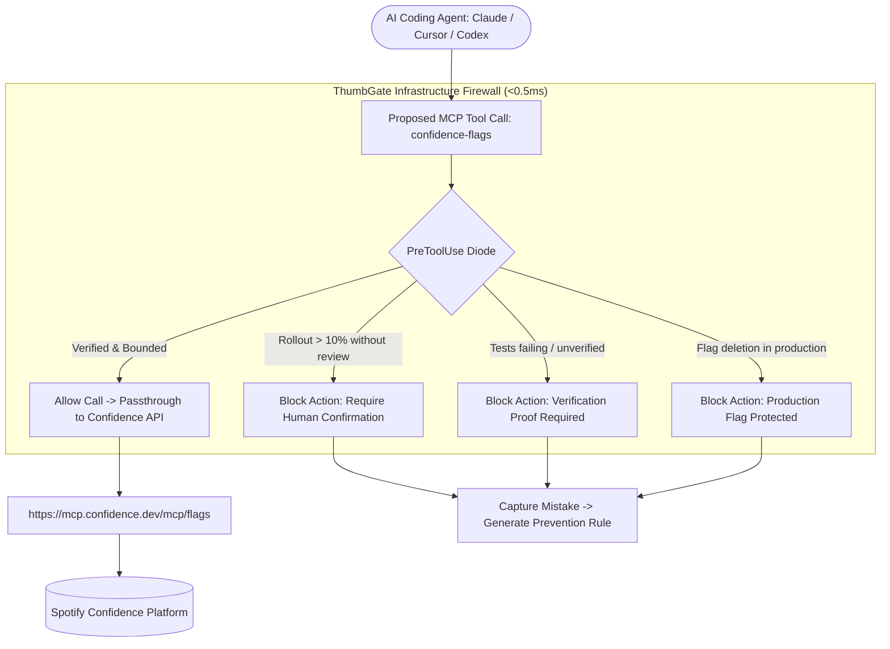

# Spotify Confidence + ThumbGate Pre-Action Governance Diode

> "As agentic coding tools rapidly change how products are built, we knew Confidence needed to evolve... releasing Confidence Agent, Recordings, Product Analytics, Confidence Cloud, and MCP servers for AI coding agents." — Spotify Confidence Team (October 14, 2026)

Spotify Confidence (`@spotify-confidence/cli`, `mcp.confidence.dev`) brings A/B testing, feature flagging, session recording, and automated experiment management into AI coding agents across **Claude Code**, **Cursor**, and **Codex**.

However, **autonomous AI agents executing unconstrained feature flag mutations in production pose severe operational risks:**
1. **Premature 100% Rollouts:** An agent rolls out a newly written feature flag to 100% of production traffic before verification tests pass or without canary verification.
2. **Experiment Degradation:** An agent modifies active A/B experiment variants or traffic splits mid-test, corrupting statistical power.
3. **Destructive Flag Deletion:** An agent deletes a legacy feature flag during codebase refactoring while client apps still depend on it.

**ThumbGate is the Pre-Action Infrastructure Firewall for Spotify Confidence.** It intercepts `confidence-flags` MCP invocations in sub-0.5ms and enforces deterministic governance diodes before flag mutation.

---

## Architecture: The Governed Confidence MCP Loop



---

## Pre-Action Governance Diodes for Confidence

| Diode / Gate ID | Trigger Condition | Enforcement Action |
| :--- | :--- | :--- |
| `gate:confidence:rollout_ceiling` | Agent attempts to set flag rollout $>10\%$ autonomously | **BLOCKED**: Hard ceiling at 10% canary. Rollout to $>10\%$ requires explicit operator approval. |
| `gate:confidence:test_proof_required` | Agent attempts to enable a flag while CI or local regression tests are failing | **BLOCKED**: Requires same-turn test execution receipt (`status: pass`). |
| `gate:confidence:protect_active_experiment` | Agent attempts to alter variants or sample sizes on an active A/B test | **BLOCKED**: Active experiments are locked against autonomous modification. |
| `gate:confidence:prevent_flag_deletion` | Agent attempts to delete a flag in production environments | **BLOCKED**: Flags must be marked archived before deletion. |

---

## Configuration (`config.json`)

```json
{
  "name": "spotify-confidence",
  "version": "1.0.0",
  "mcpServers": {
    "confidence-flags": {
      "url": "https://mcp.confidence.dev/mcp/flags"
    },
    "confidence-docs": {
      "url": "https://mcp.confidence.dev/mcp/docs"
    }
  },
  "governance": {
    "maxAutonomousRolloutPercent": 10,
    "requireTestProof": true,
    "lockActiveExperiments": true,
    "preventProductionDeletion": true
  }
}
```

---

## Quickstart

```bash
# 1. Audit Spotify Confidence diode status
node scripts/spotify-confidence-diode.js --json

# 2. Test flag rollout evaluation
node scripts/spotify-confidence-diode.js --evaluate --flag="new-checkout" --rollout=100
```
