# Hotdata DB × ThumbGate — LanceDB Vector Store Swap POC

> **Branch**: `poc/hotdata-lancedb-swap`  
> **Partners**: Hotdata Inc. ([https://www.hotdata.dev](https://www.hotdata.dev)) × ThumbGate ([https://thumbgate.ai](https://thumbgate.ai))  
> **Authors**: Igor Ganapolsky (Founder & CTO, ThumbGate) & Eddie A. Tejeda (Co-Founder & CTO, Hotdata)

---

## 1. Overview: Swapping Local LanceDB for Hotdata DB

In standard ThumbGate deployments, `scripts/vector-store.js` stores and queries 384-dimensional feedback and lesson embeddings in a local `@lancedb/lancedb` directory (`.thumbgate/lancedb`), which creates local file-lock contention (`EBUSY`) when multiple concurrent coding agents (`Claude Code`, `Cursor`, `Codex`, `LangGraph`, `n8n`) access memory simultaneously.

This POC swaps `@lancedb/lancedb` for **Hotdata DB** (`adapters/hotdata/hotdata-vector-store.js`), giving every agent fleet:
1. **Ultra-High Concurrency Execution (Rust + Apache DataFusion + Apache Arrow)**: Zero local file-lock contention across concurrent agent streams.
2. **Unified HotSQL Vector + Relational Search (`POST /v1/query`)**: Combines HNSW/IVF cosine nearest-neighbor search (`vector_search(...)`) with relational tag/signal filters in a single HotSQL query.
3. **Sub-0.1ms `PreToolUse` Execution Diode**:
   - `gate:hotdata:runaway_query_loop`: Interdicts agents that hallucinate a column name and retry identical failing `hotdata query` calls $\ge 5$ times.
   - `gate:hotdata:destructive_write_boundary`: Allows fast read-only exploration on Hotdata snapshots while hard-blocking unbounded `DROP` / `DELETE` / `TRUNCATE` mutations on downstream production databases.

```mermaid
flowchart LR
    A[Multi-Agent Fleet<br/>Claude Code / Cursor / LangGraph] --> B[scripts/vector-store.js<br/>THUMBGATE_VECTOR_BACKEND=hotdata]
    B --> C[ThumbGate PreToolUse Diode<br/>&lt;0.1ms Loop &amp; Write-Boundary Check]
    C -->|upsertFeedback| D[POST /v1/databases/.../loads<br/>mode: replace / upsert · key: id]
    C -->|searchSimilar| E[POST /v1/query · dialect: hotsql<br/>SELECT ... FROM vector_search&#40;...&#41;]
    D --> F[Hotdata Engine<br/>Rust · DataFusion · Arrow · HNSW]
    E --> F
```



---

## 2. Quick Start (Zero Caller Changes)

```bash
# 1. Configure Hotdata credentials & select the hotdata vector backend
export THUMBGATE_VECTOR_BACKEND=hotdata
export HOTDATA_API_KEY="hd_live_..."
export HOTDATA_WORKSPACE_ID="work..."
export HOTDATA_DATABASE_ID="dbid..."
export HOTDATA_CONNECTION_ID="conn..."

# 2. Run the integration test suite (verifies upsertFeedback, searchSimilar,
#    413 presigned upload fallback, and <0.1ms PreToolUse loop interdiction)
node --test tests/hotdata-vector-store.test.js

# 3. Run the interactive CLI demo
node scripts/demo-hotdata-eddie.js
```

---

## 3. Hotdata v1 API Endpoints Wired in `adapters/hotdata/hotdata-vector-store.js`

| Operation | Hotdata Endpoint | Details |
| :--- | :--- | :--- |
| **Table Publish / Upsert** | `POST /v1/databases/{db_id}/schemas/main/tables/thumbgate_memories/loads` | First load uses `mode: "replace"`; subsequent updates use `mode: "upsert"` with `key: ["id"]` and `idempotency_key`. Automatically branches on `413 INLINE_DATA_TOO_LARGE` to `/v1/uploads` presigned PUT + `/finalize`. |
| **Vector Index Build** | `POST /v1/connections/{conn_id}/tables/main/thumbgate_memories/indexes` | Builds `{ index_name: "thumbgate_memories_vector_idx", index_type: "vector", algorithm: "hnsw", columns: ["vector"], metric: "cosine", vector_precision: "float32" }`. |
| **Nearest-Neighbor Search** | `POST /v1/query` (`X-Database-Id`, `dialect: "hotsql"`) | Executes `SELECT id, text, vector, signal, tags, timestamp, context, _distance FROM vector_search('default.main.thumbgate_memories', 'vector', '[...]', 50) ORDER BY _distance ASC LIMIT <k>`. |
