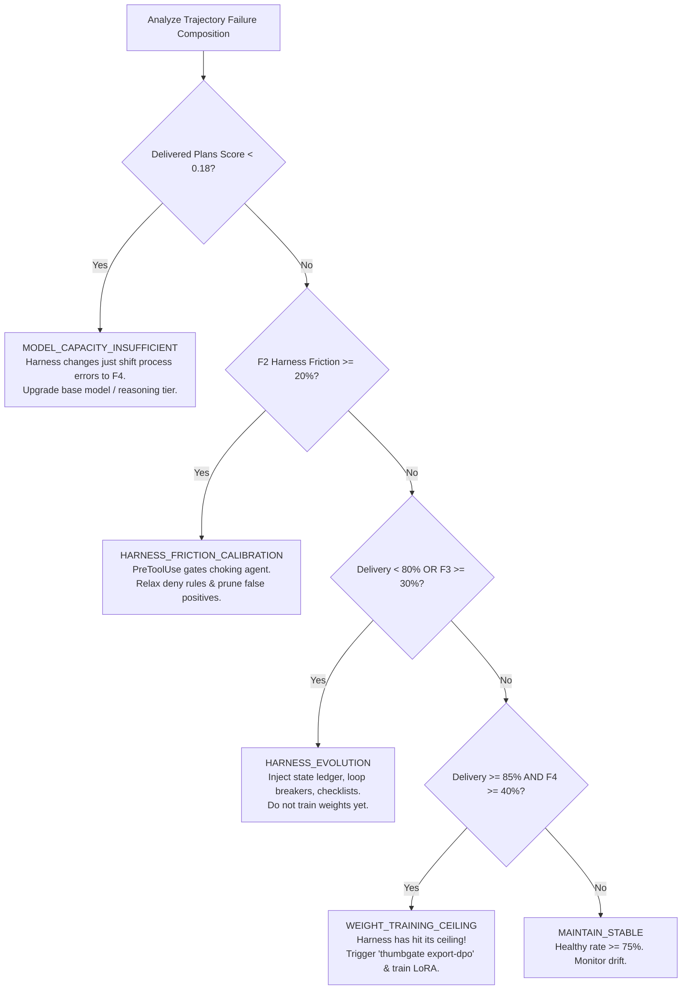

# Harness Evolution Ceiling & Weight Training Trigger (arXiv:2610.11655)

> **Paper**: *Harness Evolution Hits a Ceiling: When Weight Training Should Begin*  
> **Authors**: Yuan Tian, Bing Hu, Hao Wang, Binghang Lu, Fang Wu (October 2026)  
> **Target**: ThumbGate PreToolUse Reliability Gateway & DPO Distillation Pipeline  
> **CLI**: `npm run harness-ceiling:diagnostics` or `node scripts/harness-ceiling-diagnostics.js`

---

## 1. Executive Summary & Core Architectural Insight

When improving long-horizon autonomous AI agents, engineering teams have two primary levers:
1. **The Harness Lever**: Changing the code and runtime environment around a frozen model (prompts, tool definitions, middleware, PreToolUse execution firewalls, state ledgers, loop breakers).
2. **The Weight Lever**: Changing the underlying model weights via trajectory fine-tuning (LoRA, QLoRA, DPO preference optimization).

arXiv:2610.11655 proves empirically that **harness self-evolution hits a structural ceiling**. While harness evolution rapidly resolves process-level failures (tool thrashing, loops, step exhaustion) and boosts delivery rates, it cannot eliminate content-level failures (poor plans or flawed reasoning delivered cleanly without process exceptions).

ThumbGate steals this architectural insight into a deterministic, CPU-local (<0.5ms) diagnostic engine:
- Labels failed trajectories by the **first signal that fires** across four distinct classes ($F_1$ to $F_4$).
- Decomposes score deltas into **delivery gains vs. quality gains** ($\Delta S = \Delta r \cdot \bar{q} + r' \cdot \Delta \bar{q}$).
- Bounds selection optimism noise via **Proposition 1** ($s \sqrt{2 \ln K}$).
- Executes the **Diagnose-Then-Intervene Rule** to mathematically signal when to stop evolving the harness and trigger **Weight Training / DPO export**.
- Enforces the **Writes-vs-Sees Partition**: only edits affecting what the model *writes* can be distilled into weights; edits affecting what the model *sees* must remain in the runtime harness.

---

## 2. The Four-Class Failure Taxonomy ($F_1$ – $F_4$)

Every failed agent trajectory is labelled post hoc by the first signal that fires:

| Failure Class | Name | Operational Definition | Target Lever |
| :--- | :--- | :--- | :--- |
| **$F_1$** | **Evidence Failure** | Unbacked citation ratio $\ge 0.50$, or the agent passed an exit gate with unresolved checklist items. | **Harness** (Verification Diode / Grounding Gate) |
| **$F_2$** | **Harness Friction** | The harness itself blocked the agent ($\ge 10$ blocked tool calls or forced lock) and score is low. | **Harness** (Prune / Calibrate Overzealous Deny Rules) |
| **$F_3$** | **Execution Control** | The same tool call repeated $\ge 3$ times (loop), trajectory used $\ge 90\%$ of step budget, or timed out. | **Harness** (State Ledger / Loop Breaker / PreToolUse) |
| **$F_4$** | **Planning Capacity / Content** | None of $F_1$–$F_3$ fired; the deliverable was returned cleanly without process errors, but quality is poor (score $< 0.50$). | **Weights** (LoRA / DPO Trajectory Fine-Tuning) |
| **Healthy** | **Success** | Deliverable was completed cleanly and scored $\ge 0.50$. | Baseline Retention |

---

## 3. Mathematical Foundations

### 3.1 The Score Identity (Equation 2)
Let $r$ be the delivery rate (fraction of trajectories returning a parsable output) and $\bar{q}$ be the mean score among delivered outputs. The composite score $S$ is:
$$S = r \cdot \bar{q}$$

When transitioning from seed $(r, \bar{q})$ to evolved $(r', \bar{q}')$, the score delta $\Delta S$ decomposes into:
$$\Delta S = \underbrace{\Delta r \cdot \bar{q}}_{\text{Delivery Term}} + \underbrace{r' \cdot \Delta \bar{q}}_{\text{Quality Term}}$$

- **Harness Evolution** primarily moves the **Delivery Term** ($\Delta r \cdot \bar{q}$) by eliminating $F_2$ and $F_3$.
- Once delivery saturates ($r \to 1.0$), further gains require moving $\bar{q}$ via the **Quality Term** ($r' \cdot \Delta \bar{q}$), which is strictly the domain of **Weight Training**.

### 3.2 Proposition 1: Selection Optimism Bound
During iterative harness candidate search across $K$ candidates with $m$ rollouts:
$$\mathbb{E}\left[\max_{k} \varepsilon_k\right] \le s \sqrt{2 \ln K}, \quad \text{where } s = \frac{\sigma}{\sqrt{m}}$$

- With baseline rollout standard deviation $\sigma = 0.023$ and $m = 4$ rollouts, $s = 0.0115$.
- For $K = 10$ candidates, the bound is $\approx 0.0247$.
- **Rule**: Any candidate gain below the resolvability line ($0.035$) is treated as within noise and rejected. Fresh anchors are measured after every accepted modification to prevent selection drift.

---

## 4. The Diagnose-Then-Intervene Rule



---

## 5. What-Model-Writes vs. What-Model-Sees Partition

The paper establishes a strict boundary between what can and cannot be distilled into model weights:

1. **What Model Writes (Trainable into Weights)**:
   - System prompt instructions, output formatting constraints, tool schema preferences, prevention rules.
   - *Result*: Internalized into LoRA adapters (attention projections + MLP layers).
2. **What Model Sees (Must Stay in Runtime Harness)**:
   - Rolling history window, multi-page context, state ledger logs, runtime retrieved context.
   - *Result*: Trajectory fine-tuning *cannot* replace context that the model must perceive at runtime.

---

## 6. CLI Usage & Integration

```bash
# Run failure composition diagnostics on synthetic or default fixture
npm run harness-ceiling:diagnostics

# Output structured JSON report
node scripts/harness-ceiling-diagnostics.js --json

# Run diagnostics on custom recorded agent trace
node scripts/harness-ceiling-diagnostics.js --trace=path/to/trace.json --json

# Inspect theoretical paper mapping and constants
node scripts/harness-ceiling-diagnostics.js --map-only
```
