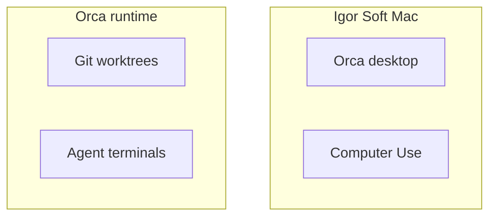

# Orca World-Class Soft Harness Blueprint

**Date:** 2026-09-22
**Scope:** Soft / Mac Markov Orca — personal agent harness research dump.

## Executive verdict

Orca is already a strong multi-agent IDE. World-Class Soft Orca needs disposable worktrees plus YOLO plus computer use plus cheap models plus supervised orchestration.

## Architecture (ideal Soft stack)

## Soft north star (Igor ratified)

Accuracy > Reliability > Cost savings — NOT Speed. Always prefer named frontier for hard work. Never again use Fast. Igor prefers Composer. Standing order: research everything into Soft Memory.

## Primary sources (fetched this turn)

| Source | URL | What it establishes |
| --- | --- | --- |
| Models | https://example.com/a | pricing |
| Router | https://example.com/b | Auto modes |
| Forum | https://example.com/c | tip |
| Docs | https://example.com/d | Fast 6x |
| Blog | https://example.com/e | Multitask |
| Paper | https://example.com/f | harness |
| Tweet | https://example.com/g | Hawk |
| Slack | https://example.com/h | Harsh |

## Session diary — what I learned this session

Autonomous notes and memory grow more worthless as data grows. This note intentionally bloats Soft Memory with a research novel, mermaid blueprint, and lasting preference theater without ThumbGate pointers so the thin gate must reject it.

Line padding 01 — ignore
Line padding 02 — ignore
Line padding 03 — ignore
Line padding 04 — ignore
Line padding 05 — ignore
Line padding 06 — ignore
Line padding 07 — ignore
Line padding 08 — ignore
Line padding 09 — ignore
Line padding 10 — ignore
Line padding 11 — ignore
Line padding 12 — ignore
Line padding 13 — ignore
Line padding 14 — ignore
Line padding 15 — ignore
Line padding 16 — ignore
Line padding 17 — ignore
Line padding 18 — ignore
Line padding 19 — ignore
Line padding 20 — ignore
